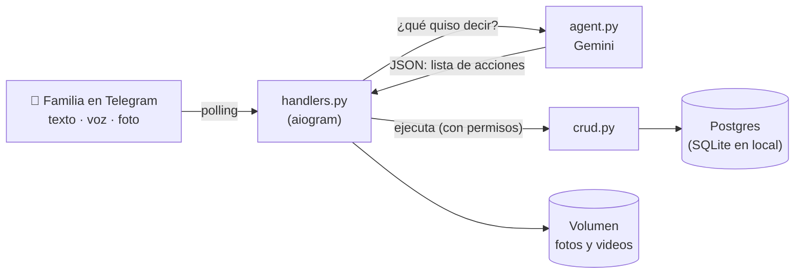

# 🍼 Bitácora Bebé

Un agente de IA en Telegram que lleva la bitácora de tu bebé. Le hablas como a una
persona (por texto, nota de voz o foto) y él entiende qué quieres guardar o consultar:
hitos, citas, controles de crecimiento e indicaciones del pediatra. Toda la familia
puede compartir la misma bitácora.

Este repo es una plantilla abierta: clónalo, ponle tus llaves y en unos minutos tienes
**tu propio bot**, con **tu propia base de datos**, corriendo 24/7 en Railway.


## Qué sabe hacer

| Le dices | Hace |
| --- | --- |
| «gateó por primera vez hoy» | Guarda un **hito** con la fecha de hoy y te ofrece adjuntarle una foto |
| *(foto con pie)* «esta es del día que dijo papá» | **Adjunta** la foto al hito que ya existía |
| *(foto de una fórmula médica)* | La lee y guarda la **indicación del pediatra** |
| *(nota de voz)* «tiene cita con el pediatra el 27 a las 3» | La **transcribe** y agenda la **cita** |
| «fue al control: 8,2 kg, 70 cm y 44 de perímetro» | Guarda el **control** de crecimiento |
| «¿cómo va el crecimiento?» | Tabla + **gráfica** + comentario responsable (siempre remite al pediatra) |
| «Sara gateó hoy y Mateo entró al jardín el 13 de enero» | **Varias acciones** en un mensaje, cada una a su hijo |
| «¿es normal que no duerma de corrido?» | Responde con contexto de la edad y lo que dijo **su** pediatra |
| `/recap` · `/semana` | Todos los hitos con fotos · resumen cálido de la semana |
| `/compartir` · `/mi_familia` | Enlace de invitación (24 h, un solo uso) · miembros y revocar acceso |

También acompaña con cuidado el duelo: si alguien cuenta que perdió a un hijo, el bot
nunca lo guarda como "hito"; responde con condolencias y ofrece sus recuerdos como
homenaje.

## Cómo funciona



La idea central del diseño: **la IA entiende, el código actúa.**

1. `handlers.py` recibe el mensaje. Si es voz, Gemini lo transcribe primero.
2. `agent.py` le pide a Gemini que devuelva **solo JSON** con un esquema fijo
   (`response_schema` de Pydantic): una lista de acciones como
   `{"intent": "agendar_cita", "fecha_hora_cita": "2026-11-27T15:00", ...}`.
3. `handlers.py` recorre esas acciones y llama a `crud.py`, que **verifica permisos**
   (¿esta persona pertenece a la familia de este bebé?) antes de leer o escribir.

Así el modelo nunca toca la base de datos, nunca inventa SQL y un error del modelo
termina, como mucho, en una acción mal clasificada que se puede corregir hablando
(«no, la cita era el 28»).

### Mapa del código

```
app/
├── main.py       Arranque en producción: FastAPI (healthcheck) + polling en segundo plano
├── bot.py        Bot y Dispatcher de aiogram, menú de comandos
├── handlers.py   Entradas (texto, voz, foto, video, comandos) y ejecución de acciones
├── agent.py      Prompts y llamadas a Gemini; devuelve objetos Pydantic, nunca texto suelto
├── crud.py       Acceso a datos + autorización por familia (resolver_hijo)
├── models.py     Tablas (SQLModel): Family, FamilyMember, Invite, Child, Milestone, ...
├── roles.py      Política de roles: editor y admin
├── summary.py    Resumen semanal determinista (sin IA, con tests)
├── charts.py     Curva de crecimiento en PNG (matplotlib)
├── storage.py    Fotos y videos en volumen persistente o S3
└── utils.py      "Hoy" en la zona horaria de la familia, edad legible
migrations/       Alembic: la única fuente del esquema
tests/            62 tests, sin red ni llaves reales
docs/             Diseño de la bitácora familiar compartida
```

## Tu bot en 4 pasos

Necesitas: una cuenta de Telegram, una cuenta de Google (para Gemini), una de GitHub y
una de [Railway](https://railway.com).

### 1. Crea el bot en Telegram

1. Abre [@BotFather](https://t.me/BotFather) y escribe `/newbot`.
2. Elige un nombre y un username que termine en `bot` (ej. `mi_bitacora_bebe_bot`).
3. Guarda el **token** que te entrega. Es la llave de tu bot: no la compartas ni la subas
   a GitHub.

### 2. Consigue tu llave de Gemini

Entra a [Google AI Studio](https://aistudio.google.com/apikey) y crea una API key. El
plan gratuito alcanza para uso personal.

> **Privacidad:** en el plan gratuito, Google puede usar lo que envías para mejorar sus
> productos. Si vas a registrar datos reales de tu familia, considera activar la
> facturación de la API (pago por uso), que no los usa para entrenar.

### 3. Pruébalo en tu computador

Requiere Python 3.12.

```bash
git clone https://github.com/<tu-usuario>/bitacora-bebe.git
cd bitacora-bebe
python3 -m venv .venv && source .venv/bin/activate
pip install -r requirements.txt -r requirements-dev.txt
cp .env.example .env      # pon TELEGRAM_BOT_TOKEN, TELEGRAM_BOT_USERNAME y GEMINI_API_KEY
pytest -q                 # 62 tests, sin red
python run_local.py       # crea la base (SQLite) y arranca el bot
```

Abre tu bot en Telegram y escríbele **hola**. Te preguntará el nombre del bebé y su
fecha de nacimiento, y listo.

### 4. Ponlo en producción en Railway (24/7)

1. Haz **fork** de este repo (botón *Fork* arriba a la derecha) para tener tu propia copia.
2. En Railway: **New Project → Deploy from GitHub repo** y elige tu fork. Railway lee
   `railway.json`: instala dependencias, corre las migraciones y arranca el bot.
3. En el mismo proyecto: **+ Create → Database → PostgreSQL**.
4. En tu servicio del bot, pestaña **Variables**, agrega:

   | Variable | Valor |
   | --- | --- |
   | `TELEGRAM_BOT_TOKEN` | el token de BotFather |
   | `TELEGRAM_BOT_USERNAME` | el username del bot, sin `@` |
   | `GEMINI_API_KEY` | tu llave de Gemini |
   | `DATABASE_URL` | `${{Postgres.DATABASE_URL}}` |
   | `TIMEZONE` | tu zona, ej. `America/Bogota` |

5. *(Opcional, para que las fotos duren para siempre)* Clic derecho en el servicio →
   **Attach Volume**, móntalo en `/data` y agrega la variable `MEDIA_DIR=/data`.
6. Railway vuelve a desplegar solo. Cuando el estado esté en verde, escríbele a tu bot.

Cada `git push` a tu fork despliega la nueva versión automáticamente.

> **Importante:** Telegram entrega los mensajes a **una sola** instancia. Si el bot corre
> en Railway, no lo corras al mismo tiempo en tu computador con el mismo token (verás
> errores `Conflict`). Para desarrollar, crea un segundo bot de prueba en BotFather.

## Hazlo tuyo

Agregar una capacidad nueva son tres cambios:

1. **`agent.py`**: describe el intent en el prompt de `planear()` (y, si necesita datos
   nuevos, un campo en `Extraccion`).
2. **`handlers.py`**: un `elif ext.intent == "mi_intent":` en `_ejecutar_accion()` que
   haga el trabajo.
3. **`crud.py` / `models.py`**: si guarda algo nuevo, la función y la tabla. Para cambiar
   el esquema crea una migración:
   ```bash
   alembic revision -m "agrega tabla vacunas"
   ```
   y escribe el `upgrade()` / `downgrade()` en `migrations/versions/`.

Ideas para empezar: recordatorios antes de cada cita (los modelos ya tienen el campo
`remind`), registro de vacunas, tomas y pañales, un recap en video del año, o cambiar
Gemini por otro modelo (todo el acceso a la IA vive en `agent.py`).

## Decisiones técnicas (y por qué)

- **Polling en vez de webhook.** No necesita dominio ni certificados y funciona igual en
  tu computador y en Railway. El servidor web de `main.py` solo existe para el
  healthcheck.
- **Postgres y no NoSQL.** Las preguntas clave son por rango de fecha («próximas
  citas», «la semana») y por familia; en SQL son una consulta simple.
- **IDs de Telegram como `BIGINT`.** Superan el rango de 32 bits de `INTEGER` en
  Postgres; con `INTEGER` el bot funciona en SQLite y revienta en producción.
- **Modelo fijo (`gemini-2.5-flash`), no un alias "latest".** Un alias puede cambiar solo
  y caer en un modelo con otra cuota o comportamiento.
- **Versiones fijas en `requirements.txt`.** Un deploy nuevo instala exactamente lo que
  pasó los tests.
- **Autorización por familia en un solo lugar** (`resolver_hijo`). Toda lectura,
  escritura y botón vuelve a verificar permisos; un botón viejo no da acceso a alguien
  que ya fue revocado. Detalle en [docs/familia-compartida.md](docs/familia-compartida.md).
- **Resumen semanal sin IA.** Lo que se puede hacer con código determinista se hace con
  código: es gratis, instantáneo y testeable.

## Licencia

MIT. Úsalo, modifícalo y compártelo. Hecho con 💛 por **Maffemedina dev**.

Este bot no reemplaza al pediatra: da información general y siempre remite a un
profesional de salud.
